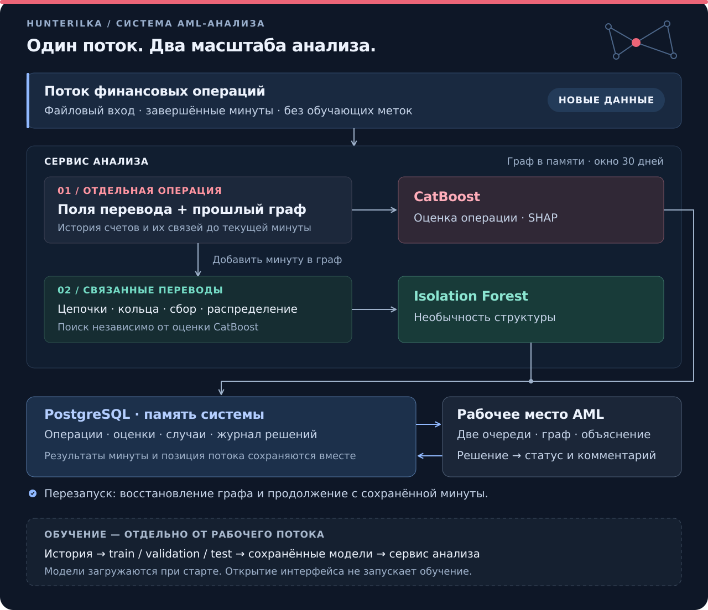

<h1 align="center">Hunterилка</h1>

<p align="center"><strong>От потока переводов — к связанному случаю для расследования.</strong></p>
<p align="center">Два уровня ML-анализа · динамический граф · рабочее место AML-специалиста</p>
<p align="center"><strong>Python 3.12 · CatBoost · Isolation Forest · NetworkX · PostgreSQL · Docker · Streamlit</strong></p>

<p align="center">
  <a href="#архитектура">Архитектура</a> ·
  <a href="#результаты">Результаты</a> ·
  <a href="#стек">Стек</a> ·
  <a href="#локальный-запуск">Запуск</a> ·
  <a href="docs/traceability.md">Требования и проверки</a> ·
  <a href="#версии">Версии</a>
</p>

Hunterилка — **программная система для специалиста по финансовому мониторингу (AML) в банке**. Она помогает выбрать операции для проверки, восстановить движение средств между счетами и сохранить решение с его обоснованием.

Система оценивает **отдельные операции и связанные группы переводов**. Специалист получает карточку случая: исходные переводы, граф связей, основания сигнала, объяснение модели и историю рассмотрения. Предметная область — выявление потенциальных схем отмывания средств; окончательное решение принимает специалист.

## Стек

| Технология | Роль в системе |
|---|---|
| **Python 3.12** | Сервис обработки, ML-процесс и интерфейс |
| **CatBoost · scikit-learn / Isolation Forest** | Оценка операций, SHAP и оценка необычности структур |
| **NetworkX** | Динамический граф, связи счетов и обходы |
| **pandas · NumPy · PyArrow** | Подготовка данных, признаки, метрики и таблицы Parquet |
| **PostgreSQL 16 · psycopg · Docker Compose** | Рабочее хранилище, транзакции, восстановление и локальный запуск БД |
| **Streamlit · PyVis** | Рабочее место и интерактивный граф случая |

CatBoost поддерживает обучение на NVIDIA GPU и CPU. Графовые расчёты и Isolation Forest выполняются на CPU. Зависимости закреплены в `requirements.txt`.

## Почему два уровня анализа

Один перевод может выглядеть обычно, но стать значимым в цепочке, кольце или распределении средств. Поэтому проверяется и сама операция, и её связи с другими переводами.

| Уровень | Какой вопрос решает | Как работает | Что получает специалист |
|---|---|---|---|
| **Операция** | Насколько подозрителен новый перевод с учётом прошлого? | CatBoost: поля операции, история счетов и графовые признаки | Приоритет операции и SHAP-объяснение вклада признаков |
| **Структура** | Насколько необычно сочетание связанных переводов? | Независимый поиск кандидатов, затем Isolation Forest по их признакам | Состав группы, оценку необычности и признаки структуры |

**Структурный поиск не отсекается порогом CatBoost.** Он может сформировать случай из переводов с невысокими индивидуальными оценками. Поддерживаются цепочки, кольца, взаимные пары, сбор, распределение и составные структуры.

**Две очереди рассмотрения:** операции упорядочены по оценке CatBoost, структуры — по необычности. Оценки относятся к разным объектам, сохраняются раздельно и не складываются в один балл. Основания обеих моделей видны в карточке.

## Архитектура

<p align="center">
  
</p>

Сервис принимает **завершённые минуты новых операций** и обрабатывает каждую в одном порядке:

1. **Оценить переводы по прошлому.** CatBoost использует историю, накопленную до текущей минуты.
2. **Добавить минуту в граф и найти структуры.** Isolation Forest оценивает найденные сочетания переводов.
3. **Сохранить результат целиком.** Операции, оценки, случаи и позиция потока записываются одной транзакцией PostgreSQL.

Все переводы одной минуты видят одинаковую предшествующую историю. Перестановка строк внутри минуты не создаёт искусственного порядка «раньше — позже».

**Граф находится в оперативной памяти; PostgreSQL сохраняет состояние работы.** В БД находятся операции рабочего окна, оценки, случаи, их версии, решения специалиста и место остановки потока. После перезапуска сервис восстанавливает граф и продолжает с сохранённого места. Рабочее окно — 30 дней; карточки случаев и журнал решений сохраняются после выхода операций из окна.

**Обучение выполняется отдельно.** Подготовка данных, расчёт признаков, обучение и оценка запускаются через `scripts/`; модели и аналитические файлы сохраняются отдельно от рабочей БД. Сервис загружает готовые модели. Новым операциям не нужны обучающие метки или деление на train/test. [Подробности архитектуры →](docs/architecture.md)

## Рабочее место специалиста

- **Выбрать, что проверить.** Две очереди, фильтры по периоду, форме связей и статусу; переход между карточками.
- **Оценить поток за период.** Число операций и сигналов, динамика по дням, счётчики новых, требующих проверки и рассмотренных случаев.
- **Восстановить движение средств.** Направленный граф, суммы, время и участники каждого перевода; переключение между отдельными переводами и объединёнными связями. Вкладка «Сеть» позволяет найти счёт или банк и раскрыть окружение в рабочем окне.
- **Понять основание сигнала.** Две оценки, SHAP выбранной операции и признаки структуры. SHAP использует сохранённый вход той же версии модели, которая создала случай.
- **Зафиксировать результат.** Статус, комментарий и имя специалиста; журнал решений, версии случая, экспорт JSON и CSV.

Красные связи показывают основание сигнала, серые — дополнительный контекст на момент обнаружения. Будущие переводы в сохранённое окружение не попадают.

В браузер передаётся **выбранный участок сети**: обычно до 40 счетов и 80 переводов, в расширенном режиме — до 100 и 200. Полный граф остаётся в сервисе. Счётчики операций используют рабочее окно БД, а сохранённые случаи доступны и за более ранние периоды. [Сценарий работы →](docs/operations.md)

## Результаты

<!-- RESULTS_START -->

Локальный эксперимент на **синтетическом IBM HI-Small**. Модель **B_plain** проверена на **всём отложенном test: 986 286 операций**.

| Масштаб расчёта | Первые 500 по оценке модели | Вклад графовых признаков |
|:---:|:---:|:---:|
| **4 930 063 операций** | **488 с положительной меткой** | **+53 при том же объёме проверки** |
| Полный исходный период · 17,68 дня | Precision@500 = **97,60%** | B_plain: 488 · A_plain: 435 |

В test 1 784 положительных операций; первые 500 охватывают **27,35%** из них. **AP 0,6952 · ROC AUC 0,9895.** Это качество ранжирования на данном наборе, а не доля всех нарушений, выявляемых в банковском потоке.

При отдельном пороге, выбранном на validation: **положительных операций найдено 242, ложных сигналов — 2**. Второй уровень добавил **14 положительных операций** сверх пороговых сигналов первого. Ранжирование первых 500 и отбор по порогу — разные режимы оценки.

Обучение CatBoost выполнено локально на **GPU**. Качество различается между временными периодами; [полный отчёт](docs/results.md) содержит сравнение моделей, оценку структур и дополнительные срезы.

<!-- RESULTS_END -->

**Что сравнивалось.** A использует поля операции и историю счетов, B добавляет графовые признаки. Каждый вариант обучен с весами классов и без них — четыре эксперимента CatBoost.

**Как разделены данные.** Временной порядок повторяет рабочую ситуацию: обучение на прошлом, проверка на следующих операциях.

- Ранние **≈60% — train:** обучение моделей.
- Следующие **≈20% — validation:** выбор модели и порогов.
- Последние **≈20% — test:** итоговый отчёт после фиксации выбора.

Группы одинакового времени не разрываются. Это схема исторического эксперимента; работающий сервис принимает последующие операции непрерывно.

Для структур отдельно оцениваются охват кандидатов, отбор Isolation Forest и дополнительные находки сверх CatBoost. Положительная операция внутри структуры служит приближённой меткой для оценки, а не подтверждением всей схемы отмывания. [Методика ML-оценки](docs/ml_evaluation.md) · [Описание данных](docs/data_card.md).

## Инженерные решения

Приём и анализ потока, хранение, интерфейс и обучение разделены. **Сервис обработки и Streamlit работают отдельными процессами с общей PostgreSQL**; вычислительное ядро не зависит от интерфейса.

| Решение | Зачем оно нужно |
|---|---|
| **Три представления графа** | Отдельные события сохраняют детали переводов, агрегированные связи между счетами используются для поиска, компактный снимок случая — для рассмотрения |
| **Скользящая история** | Граф хранит до 30 дней; отдельные окна 1 ч и 24 ч описывают недавнюю активность счетов |
| **Признаки только по прошлому** | Будущие переводы не влияют на уже рассчитанные оценки; вся минута обрабатывается по одной предшествующей истории |
| **Ограниченный поиск структур** | Глубина, число просмотренных связей и кандидатов задаются конфигурацией; неполный поиск отмечается в карточке |
| **Одна транзакция БД на минуту** | При сбое не остаётся записанной только часть операций, случаев или позиции потока |
| **Восстановление и проверка повторов** | Сервис продолжает с сохранённого места; повтор последней записанной минуты не создаёт дубликатов |
| **Снимок, версии и журнал решений** | Основание сигнала и история рассмотрения остаются доступны после изменения рабочего графа |
| **Совместимость модели и признаков** | Проверяются версия и порядок признаков, настройки и контрольные суммы моделей; несовместимое продолжение останавливается с объяснением |


## Структура репозитория

| Путь | Ответственность |
|---|---|
| `app.py`, `src/visualization.py` | Рабочее место, очереди, граф и рассмотрение |
| `config.json` | Окна истории, ограничения поиска, параметры моделей и контекста |
| `src/incoming.py`, `scripts/run_inbox.py` | Проверка новых файлов, порядок минут и подтверждение обработки |
| `src/service.py`, `src/pipeline.py` | Два уровня анализа, сохранение результата и восстановление |
| `src/graph.py`, `src/features.py`, `src/patterns.py` | Состояние графа, признаки и поиск связанных переводов |
| `src/cases.py`, `src/context.py` | Формирование случая и сохранение его окружения |
| `src/db.py`, `db/schema.sql` | Операции, случаи, версии, решения и позиция потока |
| `src/data.py`, `src/models.py`, `src/contracts.py` | Подготовка истории, загрузка и объяснение моделей, проверка совместимости |
| `scripts/`, `src/metrics.py`, `src/report.py` | Подготовка, обучение, оценка, воспроизведение истории и сборка поставки |
| `artifacts/`, `reports/` | Обученные модели и их метаданные; численные результаты |
| `tests/`, `.github/workflows/` | Автоматические проверки и CI с PostgreSQL 16 |
| `docs/`, `data/`, `incoming/` | Документация; локальные данные; каталог новых операций создаётся при запуске источника |

## Локальный запуск

Команды выполняются из папки с `app.py`, в активированном Python-окружении. PostgreSQL запускается в Docker, сервис анализа и интерфейс — отдельными Python-процессами.

**Для установленной копии с зависимостями и обученными моделями:**

```bash
sudo docker compose up -d --wait --wait-timeout 90 postgres
python -m scripts.check_runtime
python -m streamlit run app.py
```

Рабочее место доступно на [localhost:8501](http://localhost:8501). В отдельном терминале запускается источник обработки:

| Режим | Модуль | Назначение |
|---|---|---|
| **Новые операции** | `scripts.run_inbox` | Приём файлов завершённых минут, ожидание следующих файлов и продолжение после остановки |
| **Демонстрация** | `scripts.run_stream` | Воспроизведение подготовленной истории через тот же сервис анализа |

Параметры источника и БД: [установка и запуск](docs/installation.md). Формат новых операций не привязан к датам IBM: [контракт входных данных](docs/input_contract.md).

<details>
<summary><strong>Первое обучение при установке из исходников</strong></summary>

Исходники публикуются без датасета и весов. После установки зависимостей укажите путь к IBM CSV:

```bash
python -m scripts.run_pipeline --input /полный/путь/HI-Small_Trans.csv --device GPU
```

Для CPU используется `--device CPU`. Расчёт сохраняет модели и обновляет отчёт. Уже обученная установленная копия использует свои модели при обновлении программы.

</details>

**Комплект для получателя:** `python -m scripts.package_release` собирает программу с обученными моделями для запуска без повторного обучения. Рабочие данные, содержимое БД, пароли и виртуальное окружение в комплект не входят. Происхождение данных и условия использования: [NOTICE.md](NOTICE.md).

## Проектирование и проверки

**ТРПС.** Применяется итерационно-инкрементальная схема: от графового прототипа к отдельному сервису с БД, затем к входу новых операций. Каждая версия расширяет работающую систему. Назначение, роли, декомпозиция, контракты компонентов и связь требований с проверками описаны в [архитектуре](docs/architecture.md) и [матрице требований](docs/traceability.md).

После запуска PostgreSQL:

```bash
HUNTERILKA_REQUIRE_DB=1 python -m unittest discover -s tests -v
```

Проверки охватывают порядок времени, окна, валюты, независимость признаков от меток, формы структур, совместимость моделей, запись в БД, решения специалиста, сбои и продолжение. CI использует PostgreSQL 16; отсутствие тестовой БД приводит к ошибке проверки. Сквозной сценарий рабочего места описан отдельно. [Проверяемые сценарии →](docs/testing.md)

## Область применения

Текущая поставка рассчитана на **локальный запуск и один процесс записи в рабочую БД**. Новые операции поступают через файловый вход. Подключение к АБС, корпоративная аутентификация и проверка многопользовательской нагрузки относятся к следующему этапу внедрения.

Поиск ограничен глубиной и числом просматриваемых связей; неполнота отмечается в результатах. Измеренные ML-показатели относятся к синтетическому IBM HI-Small. Сигнал служит основанием для проверки специалистом.

## Версии

### v2 — сервис обработки и PostgreSQL · текущая

Вторая версия сохраняет двухуровневый анализ и делает его отдельным сервисом. Интерфейс читает готовые случаи из БД, а обработка продолжается независимо от открытой страницы. PostgreSQL связывает операции, оценки, случаи и позицию потока одной записью результатов минуты; решения специалиста имеют собственный журнал.

Текущая доработка **v2.2** добавляет вход новых операций без привязки к учебному датасету и сборку комплекта с моделями. Она использует уже обученные модели v2 и не требует повторять расчёт при обновлении программы.

При переходе с v1 исключены два признака, зависевшие от выбранного начала загруженной истории. Модели v2 обучены заново, а результаты v1 и v2 приведены отдельно. Основное изменение версии — организация работы системы; рост ML-метрик не заявляется. [Сравнение версий →](docs/version_comparison.md)

### v1 — графовый прототип и первый полный эксперимент

Первая версия объединила динамический граф, CatBoost, независимый поиск структур, Isolation Forest и интерфейс рассмотрения. Она показала весь путь от операции до сохранённого случая и позволила провести полный эксперимент на IBM HI-Small.

Случаи, решения и состояние воспроизведения хранились в файлах. Для локального прототипа это позволяло быстро проверить идею; дальнейшее развитие потребовало общего хранилища для сервиса и интерфейса. [Исходная версия на GitHub](https://github.com/Ignissi/Hunterilka/tree/02011be03702ae207a56a6cca5f1a2561a89c579).

## Развитие системы

- **Периодическое переобучение моделей.** Обучение новых версий на накопленных данных; для CatBoost — с проверенной разметкой. Каждая версия сравнивается с рабочей на отдельном, более позднем периоде и допускается к замене только после успешной валидации. Версии данных и моделей фиксируются; предыдущая модель сохраняется для отката.
- **Интеграция с банковскими источниками.** Автоматический приём операций через адаптер к АБС или брокер сообщений, обработка задержанных событий.
- **Проверка и развитие ML-анализа.** Оценка на других периодах и источниках, контроль изменения данных и качества. Улучшение структурного отбора по дополнительным находкам при одинаковом количестве карточек для проверки.
- **Масштабирование графа и хранения.** Работа с большим потоком и длительным архивом операций, резервное копирование, измерение скорости и памяти на целевой нагрузке.
- **Развитие рабочего места.** Корпоративная аутентификация и права доступа; отдельный веб-интерфейс при расширении сценариев совместной работы.

**GNN — возможная исследовательская ветка.** В текущей версии связи уже используются через графовые признаки CatBoost и отдельный поиск структур. Графовую нейросеть имеет смысл добавлять после сравнения с этой базой по качеству, памяти и задержке обработки: преимущество GNN для данной задачи ещё не установлено. В текущую реализацию она не входит.
